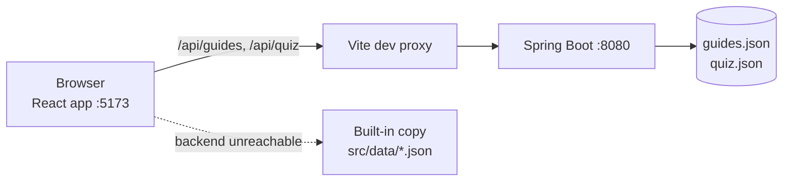

# First Aid Made Simple

An illustrated, interactive first aid learning website built for a **Youth Red Cross (YRC)** initiative.

Instead of long paragraphs of text, every first aid action is explained with its own drawn picture, one step at a time. Learners can read a guide, revise the key points, and then test themselves with a scenario-based quiz.

> **Safety note:** This website supports learning. It does not replace a certified first aid course. Always call your local emergency number in a serious emergency.

---

## Table of contents

1. [Features](#1-features)
2. [Tech stack](#2-tech-stack)
3. [Project structure](#3-project-structure)
4. [Prerequisites](#4-prerequisites)
5. [How to run the project](#5-how-to-run-the-project)
6. [How the website works](#6-how-the-website-works)
7. [API reference](#7-api-reference)
8. [Running the tests](#8-running-the-tests)
9. [Building for production](#9-building-for-production)
10. [Editing the content](#10-editing-the-content)
11. [Accessibility](#11-accessibility)
12. [Troubleshooting](#12-troubleshooting)
13. [Disclaimer](#13-disclaimer)

---

## 1. Features

| Feature | Description |
|---------|-------------|
| **6 first aid guides** | Burns, Bleeding, Choking, Fainting, Snake bites and Fractures |
| **30 illustrated steps** | 5 steps per guide. Each step has its own custom SVG illustration (no stock photos) |
| **Warnings and tips** | Red "Warning" boxes show what *not* to do. Green "Good to know" boxes give helpful extras |
| **Guide search and filter** | Find a guide quickly, or filter by level (Beginner, Essential, Intermediate) |
| **Step-by-step viewer** | Previous/Next buttons, progress bar, clickable thumbnails, arrow-key navigation and tap-to-zoom |
| **Completion screen** | After the last step: key actions to remember and when to call for help |
| **Quick revision** | Tabbed one-glance summary of every guide |
| **First aid kit explorer** | Tap or hover over kit items to see what each one is used for |
| **Check, Call, Care** | The three habits to apply before any first aid step |
| **12-question quiz** | Real-life scenarios with a picture, instant feedback, an explanation, a score and "topics to review" |
| **Offline mode** | If the backend is not running, the site still works using a built-in copy of the content |
| **About YRC** | Short introduction to Youth Red Cross and the seven fundamental principles |
| **Emergency numbers** | 112 and 108 are shown in the guide viewer and in the About YRC section |

---

## 2. Tech stack

| Layer | Technology |
|-------|-----------|
| Frontend | React 18, Vite 5, plain CSS, hand-made SVG illustrations |
| Frontend tests | Vitest, React Testing Library, jsdom |
| Backend | Java 17, Spring Boot 3.3.5 (Spring Web + Validation) |
| Backend tests | JUnit 5, Spring MockMvc |
| Content storage | Two JSON files (`guides.json`, `quiz.json`). No database is needed |
| Build tools | npm (frontend), Maven (backend) |

---

## 3. Project structure

```
First-aid/
├── backend/                              Spring Boot REST API (port 8080)
│   ├── pom.xml                           Maven build file
│   └── src/
│       ├── main/
│       │   ├── java/org/yrc/firstaid/
│       │   │   ├── FirstAidApplication.java     Application entry point
│       │   │   ├── config/WebConfig.java        CORS settings
│       │   │   ├── controller/
│       │   │   │   ├── GuideController.java     /api/guides
│       │   │   │   ├── QuizController.java      /api/quiz
│       │   │   │   ├── HealthController.java    /api/health
│       │   │   │   └── ApiExceptionHandler.java Friendly JSON error messages
│       │   │   ├── model/                       Guide, QuizQuestion, QuizSubmission, QuizResult
│       │   │   └── service/ContentService.java  Loads JSON, validates it, scores quizzes
│       │   └── resources/
│       │       ├── application.properties       Port and CORS origins
│       │       └── data/
│       │           ├── guides.json              The six guides (source of truth)
│       │           └── quiz.json                The 12 quiz questions (source of truth)
│       └── test/java/.../ApiTest.java           API tests
│
└── frontend/                             React + Vite app (port 5173)
    ├── index.html
    ├── package.json
    ├── vite.config.js                    Dev server and /api proxy
    ├── scripts/sync-data.mjs             Copies backend JSON into the frontend
    └── src/
        ├── main.jsx                      React entry point
        ├── App.jsx                       Page layout, routing, data loading
        ├── api.js                        Talks to the backend, with offline fallback
        ├── styles.css                    All styling
        ├── components/                   Navbar, Hero, GuideLibrary, GuideViewer,
        │                                 HowItWorks, KitSection, KnowBefore,
        │                                 QuickRevision, Quiz, About, Footer, ...
        ├── hooks/                        useRoute (hash router), useReveal (scroll animation)
        ├── illustrations/                The SVG artwork, one scene per step
        └── data/                         Offline copy of guides.json and quiz.json
```

---

## 4. Prerequisites

| Tool | Version | Check with |
|------|---------|-----------|
| Node.js | 18 or newer (20+ recommended) | `node -v` |
| Java JDK | 17 or newer | `java -version` |
| Maven | 3.9 or newer | `mvn -v` |

**Install links:** [nodejs.org](https://nodejs.org), [adoptium.net](https://adoptium.net) (JDK), [maven.apache.org](https://maven.apache.org/download.cgi)

- **Windows (winget):** `winget install OpenJS.NodeJS.LTS EclipseAdoptium.Temurin.17.JDK Apache.Maven`
- **macOS (Homebrew):** `brew install node openjdk@17 maven`

> Only want to see the website? You need **Node.js only**. Java and Maven are needed for the backend.

---

## 5. How to run the project

First, get the code:

```bash
git clone <your-repository-url>
cd First-aid
```

There are two ways to run it.

### Option A: Quick start (frontend only)

Use this if you only want to view the website. It needs just Node.js.

```bash
cd frontend
npm install
npm run dev
```

Open **http://localhost:5173** in your browser.

The footer will say **"Offline mode: using built-in content"**. That is expected. The site is using the copy of the content stored inside the frontend, and everything works, including the quiz.

### Option B: Full stack (frontend + Spring Boot backend)

Use two terminals.

**Terminal 1: start the backend**

```bash
cd First-aid/backend
mvn spring-boot:run
```

The first run downloads dependencies, which can take a minute or two. Wait for the line `Started FirstAidApplication`.

Check it works by opening **http://localhost:8080/api/guides**. You should see JSON for six guides.

**Terminal 2: start the frontend**

```bash
cd First-aid/frontend
npm install
npm run dev
```

Open **http://localhost:5173**.

The footer now shows a green dot and **"Content loaded from the Spring Boot server"**, which confirms the two parts are connected.

Stop either server with `Ctrl + C`.

---

## 6. How the website works

### 6.1 Big picture



1. The browser loads the React app from the Vite dev server (port 5173).
2. The app asks for `/api/guides` and `/api/quiz`. In development, Vite **proxies** any `/api` request to Spring Boot on port 8080 (set in `frontend/vite.config.js`).
3. Spring Boot reads the content from JSON files and returns it.
4. If the request fails for any reason, the app silently switches to the offline copy in `frontend/src/data/`. The footer shows which source is in use.

### 6.2 Backend

- **Start-up:** `ContentService` reads `guides.json` and `quiz.json` from the classpath into memory. It then **validates** them and refuses to start if something is wrong, for example a question that does not have exactly four options, an invalid correct-answer index, or a question that points to a topic that does not exist.
- **Serving content:** `GuideController` and `QuizController` return the data as JSON.
- **Scoring:** `POST /api/quiz/submit` compares the learner's answers with the correct ones and returns the score and a list of topics to review. Unknown or duplicate question IDs return a clean `400` error message.
- **CORS:** `WebConfig` allows the origins listed in `app.cors.allowed-origins` (the Vite dev server by default) to call the API from a browser.

### 6.3 Frontend

**Loading.** `App.jsx` calls `loadGuides()` and `loadQuiz()` from `api.js` on start. While waiting, a spinner is shown. When both finish, the page renders and the footer records whether the data came from the `server` or from `offline` content.

**Routing.** The site uses a tiny hash router (`useRoute.js`) with no extra library:

| URL | Shows |
|-----|-------|
| `#/` | The home page (all sections) |
| `#/guide/burns` | The Burns guide viewer (same pattern for every guide ID) |

An unknown guide ID shows a friendly "We could not find that guide" page.

**Home page sections (top to bottom):**

1. **Hero:** headline, illustration and the "Explore First Aid" / "Take the Quiz" buttons
2. **Guide library:** six guide cards with search and level filters. Hovering a card scales the illustration. On touch screens the same effect plays when pressed
3. **How it works:** four clickable stages (Choose, Follow the pictures, Spot the warnings, Practise)
4. **First aid essentials:** interactive kit explorer
5. **Know before you act:** the Check, Call, Care habits and key reminders
6. **Quick revision:** tabbed summary of each guide's key actions and when to get help
7. **Quiz:** the scenario quiz
8. **About YRC:** the movement, its principles and emergency numbers

The navigation bar highlights the section you are currently viewing (using `IntersectionObserver`) and scrolls smoothly when you click a link. From inside a guide, clicking a nav link returns to the home page and then jumps to that section.

### 6.4 The guide viewer

Opening a guide shows one step at a time:

- A large illustration, the step title, the instruction text, and optional **Warning** and **Good to know** boxes
- **Previous / Next** buttons, a "Step 2 of 5" label and a progress bar
- Clickable **thumbnails** to jump to any step
- **Left / Right arrow keys** to move between steps
- **Tap or click the illustration to zoom**
- A permanent **"Serious emergency? Call 112 now"** card at the top
- After the last step, a **completion screen** with the guide's *key actions*, *when to call for help*, and buttons to review the steps, take the quiz, or open the next guide

### 6.5 How the illustrations work

Each step in `guides.json` has an `id` such as `burns-2`. That same `id` is the name of its illustration.

`Illustration.jsx` looks the `id` up in a `SCENES` object (built from `scenesBurnsBleeding.jsx`, `scenesChokingFainting.jsx` and `scenesSnakeFracture.jsx`) and draws that scene as an inline SVG on a tinted, rounded background. Because the pictures are code rather than image files, they are tiny, scale perfectly on any screen, and carry `alt` text for screen readers.

Shared drawing pieces (colours, hands, bodies, props) live in `parts.jsx` and `compose.jsx`.

### 6.6 How the quiz works

1. **Intro:** shows how many scenarios there are and a Start button.
2. **Shuffle:** the questions are shuffled every round, so no two attempts are the same.
3. **Each question:** a scenario picture and four options (A to D). When you pick one, the correct option turns green, a wrong pick turns red, and the others dim.
4. **Feedback:** an explanation appears, and the picture changes to show the **correct action**.
5. **Results:** after the last question the score shows immediately (calculated in the browser), then is replaced by the server's score from `POST /api/quiz/submit`. If the server is not available, the local score is kept, so the learner never sees an error.
6. **Review:** a score ring, an encouraging message, and clickable chips linking to the guides for any topics you got wrong.
7. **Try Again** reshuffles and restarts.

---

## 7. API reference

Base URL: `http://localhost:8080`

| Method | URL | Returns |
|--------|-----|---------|
| `GET` | `/api/guides` | All six guides with their steps |
| `GET` | `/api/guides/{id}` | One guide, e.g. `/api/guides/burns`. Returns `404` if unknown |
| `GET` | `/api/quiz` | The 12 quiz questions |
| `POST` | `/api/quiz/submit` | Scores a set of answers |
| `GET` | `/api/health` | `{"status":"ok","service":"first-aid-made-simple"}` |

**Guide IDs:** `burns`, `bleeding`, `choking`, `fainting`, `snake-bites`, `fractures`

**Submit a quiz** (`POST /api/quiz/submit`):

```json
{
  "answers": [
    { "questionId": "q-burns-1", "selected": 1 },
    { "questionId": "q-burns-2", "selected": 0 }
  ]
}
```

`selected` is the option index from `0` to `3`.

Response:

```json
{ "score": 1, "total": 2, "topicsToReview": ["burns"] }
```

An empty list, an unknown question ID, a duplicate question ID, or an index outside 0 to 3 returns `400` with `{"error": "..."}`.

---

## 8. Running the tests

```bash
# Frontend tests (guides, navigation, search, kit explorer, full quiz flow)
cd frontend
npm test

# Backend tests (guides, quiz, scoring, error cases)
cd backend
mvn test
```

One frontend test checks that **every step has its own illustration and that no two steps share one**, so a missing picture is caught automatically.

---

## 9. Building for production

**Frontend**

```bash
cd frontend
npm run build        # creates frontend/dist
npm run preview      # optional: preview at http://localhost:4173
```

`frontend/dist` is a static site that can be hosted anywhere (Netlify, GitHub Pages, Nginx, and so on).

If the frontend and backend are hosted at different addresses:

1. Set the API address before building:
   ```bash
   VITE_API_URL=https://your-api.example.com/api npm run build
   ```
   (On Windows PowerShell: `$env:VITE_API_URL="https://your-api.example.com/api"; npm run build`)
2. Add your site's address to `app.cors.allowed-origins` in `backend/src/main/resources/application.properties`.

**Backend**

```bash
cd backend
mvn package
java -jar target/first-aid-made-simple-1.0.0.jar
```

> A frontend deployed alone (for example on GitHub Pages) still works. It simply runs in offline mode using the built-in content.

---

## 10. Editing the content

The guides and quiz are plain JSON files. **`backend/src/main/resources/data/` is the source of truth.**

1. Edit `guides.json` and/or `quiz.json`.
2. Copy the files to the frontend's offline fallback:
   ```bash
   cd frontend
   npm run sync-data
   ```
3. Restart the backend so it loads the new JSON.

**Adding a step or a guide:** each step's `id` (for example `burns-3`) is also the name of its illustration. Add a matching scene in `frontend/src/illustrations/` (see `scenesBurnsBleeding.jsx` for examples) and register it in the exported object at the bottom of that file.

**Changing the emergency numbers:** the site uses India's numbers (112, and 108 for ambulances). For another country, search the `frontend/src` folder for `112` and `108` and replace them.

---

## 11. Accessibility

- Full keyboard navigation, with visible focus outlines and a "Skip to content" link
- Alt text on every illustration
- ARIA roles and live regions for progress, quiz feedback and tabs
- Focus moves to the new step heading or quiz feedback so screen readers announce it
- `prefers-reduced-motion` turns animations off
- Responsive layout with a mobile menu

---

## 12. Troubleshooting

| Problem | Fix |
|---------|-----|
| `Port 8080 was already in use` | Stop the other program, or set `server.port=8081` in `application.properties` and change the proxy target in `frontend/vite.config.js` |
| Footer says "Offline mode" | The backend is not running or is not on port 8080. Start it and refresh the page |
| `mvn` is not recognised | Install Maven and reopen the terminal, or open `backend/` in IntelliJ IDEA / VS Code and run `FirstAidApplication` |
| `Unsupported class file major version` | Your JDK is older than 17. Install JDK 17 or newer |
| `npm install` fails | Use Node 18+. Delete `frontend/node_modules` and try again |
| Backend refuses to start with "must have exactly 4 options" (or similar) | A mistake in `quiz.json` or `guides.json`. The message names the question or guide to fix |
| Fonts look different offline | The site uses the Manrope font from Google Fonts and falls back to system fonts |

---

## 13. Disclaimer

The first aid steps follow widely used Red Cross and NHS guidance, and the emergency numbers shown are for India. Before using the site in a school or YRC unit, have the content reviewed by a qualified first aid trainer. This website supports learning and does not replace a certified first aid course.